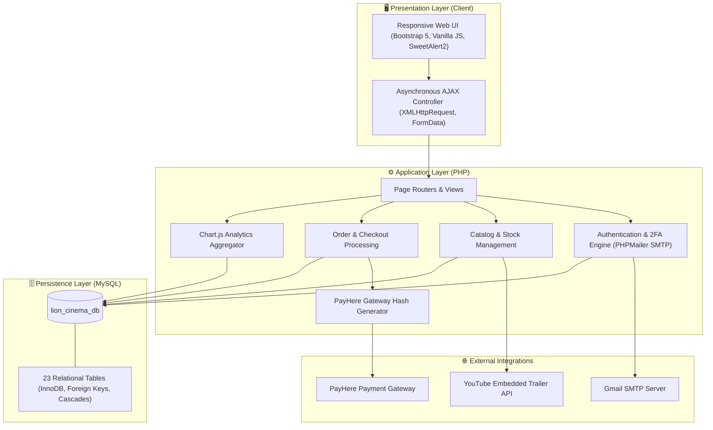

# 🎬 Lion Cinema — Full-Stack E-Commerce & Movie Media Platform

[](https://www.php.net/)
[](https://www.mysql.com/)
[](https://getbootstrap.com/)
[](https://www.payhere.lk/)
[](LICENSE)

An enterprise-grade, full-stack E-Commerce web platform developed for digital entertainment media, movies, and series distribution. Built with **Native PHP**, **MySQL**, **Bootstrap 5**, **Chart.js**, and asynchronous **AJAX**, featuring automated 2FA verification, real-time inventory management, dynamic order tracking, and integration with the **PayHere Sandbox Payment Gateway**.

---

## 📌 Executive Summary

**Lion Cinema** is designed to streamline the digital and physical distribution of movies and TV series. The application decouples customer-facing e-commerce operations from administrative back-office management, ensuring high performance, responsive user interaction, and data integrity.

### 🌟 Key Highlights
- **Dynamic Catalog & Discovery:** Multi-attribute filtering (genre, language, media type) with real-time AJAX search.
- **Interactive Single-Product Experience:** High-resolution image carousels, embedded YouTube trailer integration, verified customer reviews, and stock alerts.
- **Intelligent Cart & Checkout:** District-based dynamic logistics calculation, quantity-based free delivery thresholds, and PayHere checkout.
- **Two-Factor Administrative Security:** Two-tier administrative access (Admin & Super Admin) with automated SMTP two-factor authentication (2FA).
- **Business Intelligence Dashboard:** Real-time revenue tracking, top-selling analytics, and printable executive reports.

---

## 🏗️ System Architecture & Data Flow



---

## 🚀 Core Features & Capabilities

### 🛍️ 1. Customer Experience (Storefront)
- **Dynamic Search & Filtering:**
  - Full-text keyword search combined with category dropdowns.
  - Multi-parameter advanced filtering (Category, Type, Language, Price range, Condition, Sort by Price / Date / Popularity).
- **Interactive Movie Showcase:**
  - Multi-image zoom and thumbnail switching.
  - Official trailer integration via embedded YouTube API.
  - Dynamic stock counter with real-time inventory checks.
  - Customer feedback and star rating display.
- **Smart Cart & Watchlist:**
  - Session-persisted cart with dynamic quantity adjustments.
  - Automated shipping calculation based on Sri Lankan districts.
  - Free delivery rule triggered when cart items exceed 5 units.
- **Payment & Invoicing:**
  - Secure checkout via PayHere Payment Gateway Sandbox API.
  - Automatic invoice number generation with print-friendly layout.
  - Complete order history tracking with review submission support.

### 🛡️ 2. Administrative & Operations Control
- **Two-Tier Role-Based Access Control (RBAC):**
  - **Admin:** Catalog management, stock updates, user status toggle, and order delivery status workflow.
  - **Super Admin:** Elevated privileges to manage administrative staff, audit logs, and system metadata.
- **Two-Factor Authentication (2FA):**
  - Automated time-bound verification codes dispatched via PHPMailer SMTP.
- **Interactive Analytics Dashboard:**
  - Daily & monthly gross income tracking.
  - Top-selling media chart visualization powered by Chart.js.
  - Live metric widgets: Today's Orders, User Signups, Available Inventory.
- **Fulfillment State Machine:**
  - Order progression: `Packaging` ➔ `Delivering` ➔ `Delivered` ➔ `Finished` (with cancellation/denial controls).
- **Executive Reporting Engine:**
  - Exportable and printable tabular reports: Sales Reports, Stock Variance, User Audit, and Delivery Tracking.

---

## 🗃️ Database Architecture

The relational schema comprises **23 normalized tables** enforcing referential integrity with strict foreign key constraints:

| Domain | Tables | Description |
| :--- | :--- | :--- |
| **Identity & Access** | `user`, `admin`, `super_admin`, `gender`, `status` | Role segregation, profiles, and account lifecycle. |
| **Catalog & Media** | `product`, `product_img`, `category`, `language`, `type`, `trailer`, `availability` | Multi-image product catalog with YouTube trailer links. |
| **Commerce & Cart** | `cart`, `watchlist`, `order`, `invoice`, `delivery_status` | Transaction ledger, order lines, and logistics states. |
| **Geography** | `province`, `district`, `user_has_address` | Two-tier geographic delivery calculation system. |
| **Feedback** | `feedback` | Post-purchase customer ratings and textual reviews. |

> Complete database migration file available at [`database/schema.sql`](database/schema.sql).

---

## 💻 Tech Stack & Engineering Decisions

| Component | Technology | Rationale |
| :--- | :--- | :--- |
| **Backend** | Native PHP 8.x | Lightweight, zero-dependency overhead, high deployment speed on standard LAMP stacks. |
| **Database** | MySQL 8.0 (InnoDB) | ACID compliance, foreign key cascade integrity, robust indexing. |
| **Frontend UI** | Bootstrap 5 + CSS3 | Mobile-first responsive grid system, flexible utility classes. |
| **Interactivity** | Vanilla JavaScript (ES6) | Framework-agnostic AJAX queries (`XMLHttpRequest`, `FormData`) eliminating bundle overhead. |
| **Alerts & Visuals** | SweetAlert2, Chart.js | Modern modal feedback and interactive SVG/Canvas dashboard charts. |
| **Mailing** | PHPMailer | Reliable SMTP authentication for 2FA and transactional notifications. |
| **Payments** | PayHere Sandbox API | Secure MD5 merchant hash verification matching local payment infrastructure. |

---

## ⚙️ Installation & Local Setup

### Prerequisites
- [XAMPP](https://www.apachefriends.org/) (PHP 8.0+ and MySQL 8.0+) OR Docker Desktop
- Web Browser (Chrome, Firefox, Edge)

### Option A: Standard Setup (XAMPP)

1. **Clone the Repository:**
   ```bash
   git clone https://github.com/MalindaDasanayaka/lion-cinema-ecommerce.git
   ```
   *Place or copy the folder into `C:/xampp/htdocs/lionCinema`.*

2. **Database Initialization:**
   - Launch XAMPP and start **Apache** and **MySQL**.
   - Open **phpMyAdmin** at `http://localhost/phpmyadmin`.
   - Create a database named `lion_cinema_db` or import directly from:
     ```text
     database/schema.sql
     ```

3. **Configure Environment:**
   - Review [`connection.php`](connection.php) to ensure MySQL credentials match your environment:
     ```php
     Database::$connection = new mysqli("localhost", "root", "your_password", "lion_cinema_db", "3306");
     ```

4. **Launch Application:**
   - Storefront: `http://localhost/lionCinema/index.php`
   - Admin Sign-in: `http://localhost/lionCinema/adminSignin.php`
   - Super Admin Sign-in: `http://localhost/lionCinema/superAdminLogin.php`

---

### Option B: Containerized Execution (Docker)

Run the entire platform with a single command without installing XAMPP:

```bash
docker compose up -d
```
- Web Application: `http://localhost:8080/index.php`
- MySQL Database: `localhost:3307`

---

## 🔑 Demo Access Credentials

| Role | Email | Password | Access Scope |
| :--- | :--- | :--- | :--- |
| **Customer** | `malindadasanayaka@gmail.com` | `LionCinema@2026` | Storefront browsing, Cart, Checkout, Profile |
| **Admin** | `malindadasanayaka@gmail.com` | `LionCinema@2026` | Operations dashboard, Catalog, Order statuses |
| **Super Admin**| `malindadasanayaka@gmail.com` | *(2FA via DB `vcode`)* | Admin staff management, System settings |

---

## 🔒 Security Best Practices & Roadmap

- [x] Session-based authentication with cookie expiry controls.
- [x] MD5 Payment signature hashing for PayHere transaction verification.
- [x] Role segregation for administrative modules.
- [ ] **Roadmap Item:** Refactor raw SQL queries to **Prepared Statements (`PDO` / `mysqli_stmt`)** to eliminate SQL injection vectors.
- [ ] **Roadmap Item:** Upgrade credential persistence to **`password_hash()` (Bcrypt/Argon2id)**.
- [ ] **Roadmap Item:** Decouple monolithic scripts into an **MVC (Model-View-Controller)** pattern with Composer PSR-4 autoloading.
- [ ] **Roadmap Item:** Expose a RESTful JSON API layer with JWT authentication.

---

## 👤 Author

**Malinda Dasanayaka**
- **GitHub:** [@MalindaDasanayaka](https://github.com/MalindaDasanayaka)
- **Institution:** Birmingham City University (BCU)

---

## 📄 License

This project is licensed under the [MIT License](LICENSE) - feel free to use and adapt it for academic and educational purposes.
